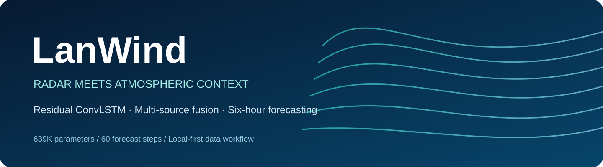
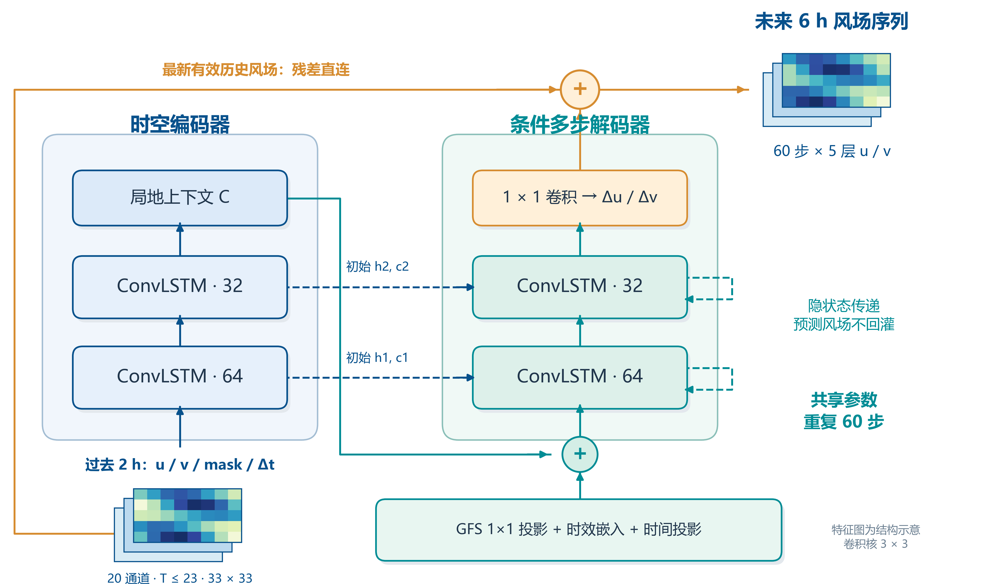
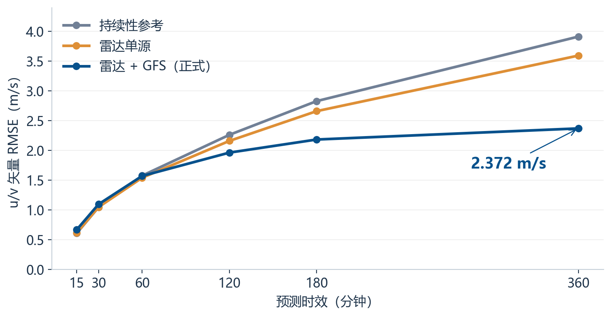
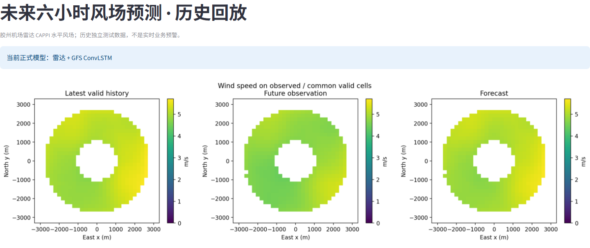

<p align="right"><a href="README.md">简体中文</a> · <strong>English</strong></p>

<p align="center"></p>

# LanWind

### Multisource wind-field forecasting with residual ConvLSTM

Combine fine-scale radar observations with GFS background evolution to forecast approximately six hours of multilevel horizontal wind from two hours of history. One model directly decodes up to 60 wind-vector frames, with local inference, training, evaluation and visualization.

**Six-hour vector RMSE: 2.37 m/s · speed MAE: 1.22 m/s · circular direction MAE: 20.8°**

[Quick start](#quick-start) · [Data schema](docs/DATA.md) · [Deployment](docs/DEPLOYMENT.md) · [Model card](docs/MODEL_CARD.md) · [简体中文](README.md)

## Highlights

- **Cross-scale conditioning:** radar captures local structure, while GFS provides background evolution during decoding.
- **Residual multistep forecasting:** two-layer encoders and decoders use 64→32 channels and 3×3 kernels. Learned changes are added to the latest valid wind; predicted u/v is never fed back.
- **Missingness and elapsed-time awareness:** inputs include u/v, an observation mask and Δt while retaining irregular native timestamps.
- **Runnable implementation:** pretrained weights, local-file inference, training, evaluation and a Streamlit dashboard.
- **No datasets distributed:** no observations, model-ready samples, GFS caches or replay arrays are included. Prepare your own authorized local data.

## Architecture



Five structural levels expand u/v, mask and Δt into 20 channels. Encoder context is combined with GFS projection, learned lead embeddings and time projection, driving a shared-parameter multistep decoder. The model has **639,082 parameters**. Feature-map textures are illustrative; inputs are radar and GFS, not satellite observations. Diagram labels are Chinese; this section and the model card describe the computation in English.

## Historical benchmark

These results use frozen weights and **11,322 historical forecast origins**. Charts and JSON contain aggregates only; the corresponding dataset is not included.



| Six-hour metric | Persistence | Radar only | Radar + GFS |
|---|---:|---:|---:|
| Vector RMSE (m/s) | 3.914 | 3.595 | **2.372** |
| Speed MAE (m/s) | 1.907 | 1.969 | **1.218** |
| Circular direction MAE (degrees) | 34.59 | 34.20 | **20.77** |

Six-hour vector RMSE decreases **39.4% against persistence** and **34.0% against radar only**. Speed error decreases **36–38%**, and direction error approximately **40%**. [Full aggregate metrics](docs/benchmark.json) retain risk results as well. Direction uses the original three-method common non-calm mask with a 1 m/s calm threshold.

Validation uses Jiaozhou Airport CAPPI observations and radar-centered Cartesian coordinates in metres. Structural heights are 100/150/200/250/300 m relative to the radar; actual paired u/v targets cover 100–250 m. Risk maps are data-driven visualization aids; improved risk identification over persistence is not claimed.

## Quick start

Use **64-bit Python 3.12**. CPU is sufficient for weight checks and individual inference.

```bash
git clone https://github.com/cuitao223/LanWind.git
cd LanWind
python -m venv .venv
```

Linux activation: `source .venv/bin/activate`. In Windows PowerShell, replace `python` below with `.venv\Scripts\python.exe`.

```bash
python -m pip install --upgrade pip
python -m pip install torch==2.7.1 --index-url https://download.pytorch.org/whl/cpu
python -m pip install -r requirements.txt
python scripts/smoke_test.py
```

The smoke test uses in-memory synthetic tensors for weight loading, shape, finite-value and causal-input checks. It is not an accuracy evaluation and creates no sample files.

## Local inference and visualization

Prepare an authorized input using the [data schema](docs/DATA.md), then run:

```bash
python scripts/infer.py --input /private/input.npz --output runs/prediction.npz --device cpu
python -m streamlit run app.py --server.address 127.0.0.1 --server.port 8502
```

Open `http://127.0.0.1:8502` and enter your local prediction path. With no file, the page shows model information. It never downloads observations automatically. Input and prediction files remain on the machine running the application.



This screenshot illustrates the existing local replay system. The public dashboard reads your own files; the screenshot's replay arrays are not provided.

## Training and evaluation

Split complete chronological ranges 70%/15%/15% into local `train/`, `val/` and `test/` directories. Windows cannot cross boundaries or long gaps. Training reads only the first two partitions and fits fresh training-only normalization, preserving released settings.

```bash
# Install CUDA-enabled PyTorch on your GPU server; see deployment docs.
python scripts/train.py --data /private/bundles --output runs/my_run --device cuda --batch-size 32
python scripts/evaluate.py --data /private/bundles/test --weights runs/my_run/best.pt --config runs/my_run/config.yaml --output runs/my_run/test_metrics.json --device cuda
```

AdamW, lr 0.001, weight decay 0.0001, masked Smooth L1, seed 42, at most 50 epochs, patience 8. Weight selection uses validation loss only. New evaluation compares LanWind and persistence using their two-method common direction mask, distinct from the original three-method benchmark. New training clears the risk threshold; fit a new 95th percentile on training data before enabling risk visualization.

## Data provenance

- Radar: authorized Jiaozhou Airport CAPPI products from the data holder. No verified public download URL is available; observations are not redistributed.
- GFS: [NOAA GFS open data](https://registry.opendata.aws/noaa-gfs-bdp-pds/), using only forecasts available at the origin.
- GFS 100 m above ground is distinct from radar-relative heights and is not treated as multiple observed radar levels.

Original source timezone and exact installation coordinates still need provider confirmation. Historical alignment uses an airport-location proxy and UTC+8 working assumption; see the [model card](docs/MODEL_CARD.md). New input requires explicit UTC seconds; wind strength cannot establish timezone.

## Layout

```text
LanWind/
├── lanwind/       # Model, causal features, local data adapter, physical metrics
├── scripts/       # Inference, training, evaluation, release checks
├── weights/       # Model state dictionary only
├── assets/        # Illustrations and aggregate result figures
├── docs/          # Input schema, deployment, model card, aggregate metrics
├── app.py         # Local-file dashboard
├── config.yaml    # Architecture and pretrained normalization
└── README.md      # Chinese documentation
```

Code and released weights use the [MIT license](LICENSE). Dataset rights remain with their providers and are not granted by this license.
