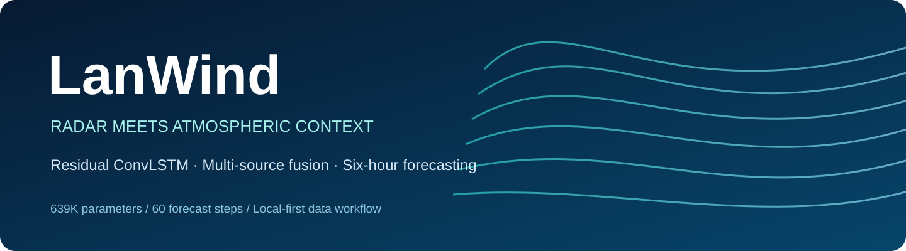
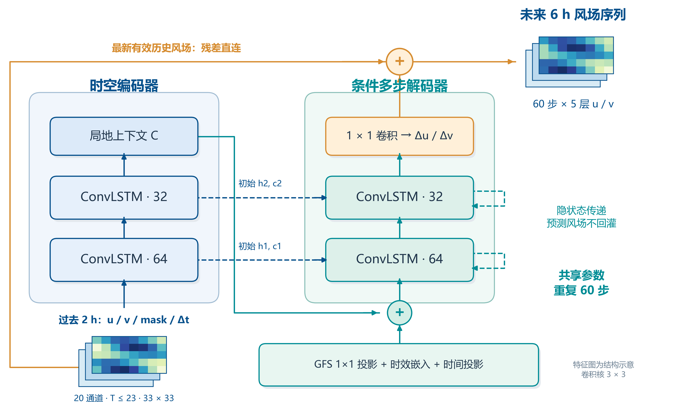
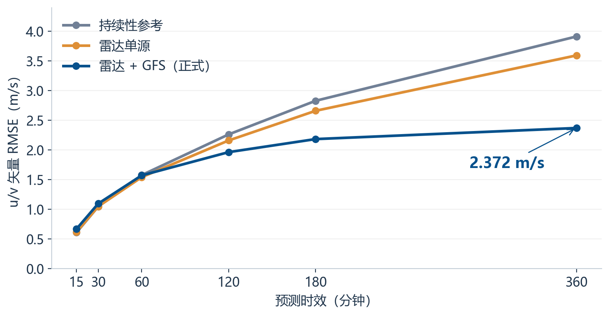
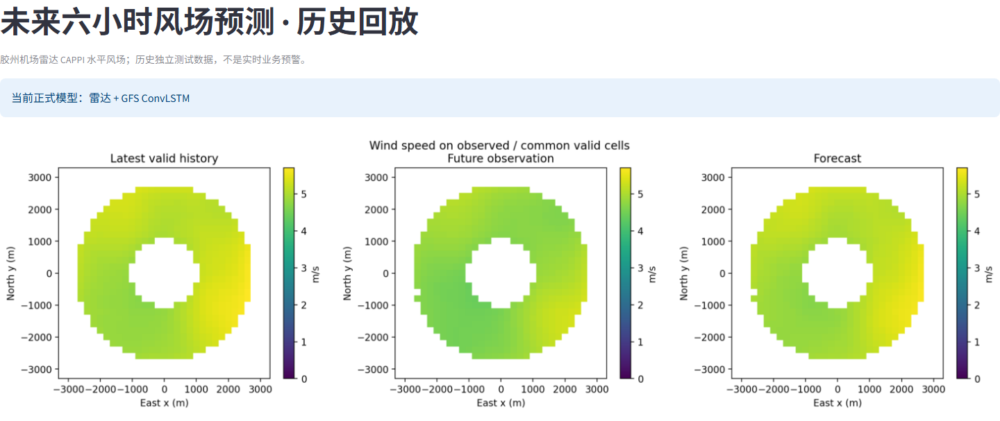

<p align="right"><strong>简体中文</strong> · <a href="README.en.md">English</a></p>

<p align="center"></p>

# 澜风 LanWind

### 基于残差 ConvLSTM 的多源融合风场预测

融合雷达的局地精细结构与 GFS 背景演变，用过去两小时的观测预测未来约六小时的多高度水平风场。单一模型直接生成最多60步风矢量序列，支持本机推理、训练、评估与可视化。

**六小时矢量 RMSE 2.37 m/s · 风速 MAE 1.22 m/s · 风向误差 20.8°**

[快速开始](#快速开始) · [数据接口](docs/DATA.md) · [部署指南](docs/DEPLOYMENT.md) · [模型说明](docs/MODEL_CARD.md) · [English](README.en.md)

## 项目亮点

- **跨尺度融合**：雷达捕捉局地结构，GFS提供背景演变，两类信息在解码阶段协同。
- **残差多步预测**：双层编码器、双层解码器均采用64→32通道、3×3卷积；预测变化量叠加最新有效风场，预测u/v不回灌。
- **缺测与时间感知**：输入包含u、v、有效掩码和Δt，保留原生不等间隔时间戳。
- **完整运行链路**：包含预训练权重、本机推理、训练入口、统一评估及Streamlit展示。
- **数据独立管理**：不分发任何数据集、观测样本、GFS缓存或预测回放文件。使用者在本机独立准备数据。

## 模型结构



五个高度的u/v、mask与Δt展开为20通道。编码上下文与GFS投影、时效嵌入、时间投影相加，驱动多步解码器。模型包含 **639,082** 个参数。图中风场纹理为结构示意；实际输入为雷达和GFS，未使用卫星观测。

## 历史评估

以下结果来自固定权重的 **11,322个历史起报窗口**。图片与JSON为汇总结果，不包含对应数据集。



| 六小时时效 | 持续性参考 | 雷达单源 | 雷达 + GFS |
|---|---:|---:|---:|
| 矢量RMSE（m/s） | 3.914 | 3.595 | **2.372** |
| 风速MAE（m/s） | 1.907 | 1.969 | **1.218** |
| 风向圆周平均误差（°） | 34.59 | 34.20 | **20.77** |

六小时矢量误差较持续性降低 **39.4%**、较雷达单源降低 **34.0%**；风速误差降低 **36%—38%**，风向误差降低约 **40%**。[完整汇总指标](docs/benchmark.json)同时保留风险结果。风向采用三种对象的共同非静风掩码，静风阈值1 m/s。

实际验证地点为胶州机场，坐标为雷达中心的米制水平距离。结构高度100/150/200/250/300 m相对雷达；有真实u/v目标用于验证的是100—250 m。风险图是数据驱动提示，未声称风险识别超过持续性参考。

## 快速开始

推荐 **Python 3.12 x64**，CPU即可检查权重和单样本推理。

```bash
git clone https://github.com/cuitao223/LanWind.git
cd LanWind
python -m venv .venv
```

Linux激活：`source .venv/bin/activate`。Windows可将以下`python`替换为`.venv\Scripts\python.exe`。

```bash
python -m pip install --upgrade pip
python -m pip install torch==2.7.1 --index-url https://download.pytorch.org/whl/cpu
python -m pip install -r requirements.txt
python scripts/smoke_test.py
```

模型检查只在内存中构造合成张量，验证加载、形状、有限值及因果约束；不代表效果评估，也不生成数据文件。

## 本机推理与展示

按[数据接口](docs/DATA.md)准备自己的输入，再运行：

```bash
python scripts/infer.py --input /path/to/private/input.npz --output runs/prediction.npz --device cpu
python -m streamlit run app.py --server.address 127.0.0.1 --server.port 8502
```

打开`http://127.0.0.1:8502`，填写本机预测文件路径。未提供文件时显示模型说明，不自动下载观测数据。输入与预测始终保存在运行程序的机器上。



截图展示已有本机历史回放效果；开源页面读取使用者自己的文件，不附带截图对应数据。

## 训练与评估

自有样本按完整时间段70%/15%/15%划分到`train/`、`val/`、`test/`，窗口不跨边界或长缺口。训练仅读取前两者，重新拟合训练集归一化参数，原预训练配置保持独立。

```bash
# 在CUDA服务器安装GPU版PyTorch，见部署指南。
python scripts/train.py --data /private/bundles --output runs/my_run --device cuda --batch-size 32
python scripts/evaluate.py --data /private/bundles/test --weights runs/my_run/best.pt --config runs/my_run/config.yaml --output runs/my_run/test_metrics.json --device cuda
```

AdamW，lr=0.001，wd=0.0001，掩码Smooth L1，seed42，最多50轮，patience8；仅按验证损失选择权重。新评估比较LanWind和持续性，采用两者共同非静风掩码，与历史三对象结果不混用。新数据训练后风险阈值为空，需从新训练集拟合95%分位阈值。

## 数据来源与坐标

- 雷达：胶州机场CAPPI水平风场，由数据持有方授权获取；没有可确认的公开下载地址，本仓库不分发。
- GFS：[NOAA GFS开放数据](https://registry.opendata.aws/noaa-gfs-bdp-pds/)，仅使用起报时已可获得的预报。
- GFS的100 m离地高度与雷达相对高度不同，不冒充多层雷达真值。

原始时区与雷达安装位置仍需提供方确认；历史对齐使用机场位置近似和UTC+8工作假设，详见[模型说明](docs/MODEL_CARD.md)。新输入接口要求明确UTC秒，不能凭风力推断时区。

## 目录

```text
LanWind/
├── lanwind/       # 模型、因果特征、数据适配与物理量
├── scripts/       # 推理、训练、评估与发布检查
├── weights/       # 仅模型状态字典
├── assets/        # 插图与汇总结果图
├── docs/          # 接口、部署、模型说明与汇总指标
├── app.py         # 本机可视化
├── config.yaml    # 架构及预训练归一化参数
└── README.en.md   # English
```

代码与发布权重采用[MIT许可证](LICENSE)。数据权利归各自提供方，不属于此许可证的授权范围。
